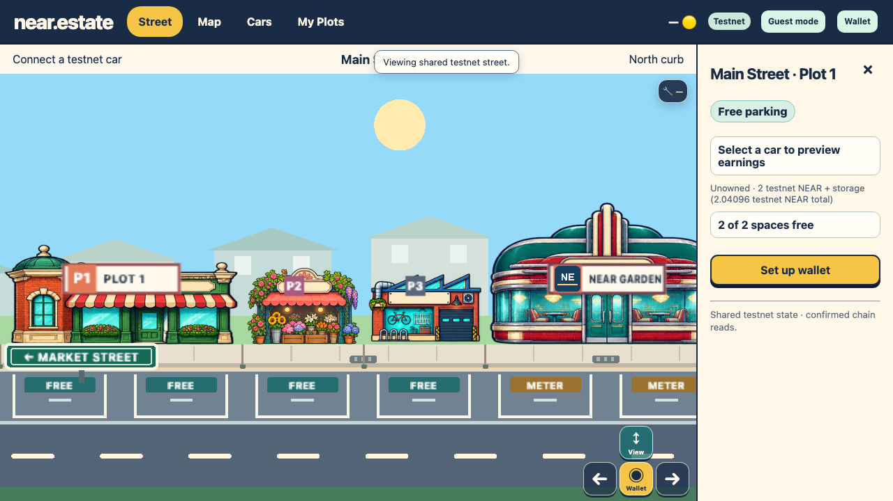

# near.estate

**Drive the city. Find a curb. Make it yours.**

near.estate is an illustrated, side-scrolling parking city for people and software agents. Drivers hunt for a space, take a calculated risk on a parking rule, collect coins, refuel, upgrade their cars and visit cinemas, burgers and race courses. Plot owners shape the same streets with buildings, parking rules, logos and billboards. The spaces, cars, ownership and payouts live on **NEAR testnet**; the moment-to-moment game feels like a browser game.

Built for the NEAR HACKATHON **Games With Real Economies** track. [Play the hosted game](https://near.estate) · [Inspect the live contract](https://testnet.nearblocks.io/address/dev-20261110121817-59798568433631.testnet) · [Check the receipts](EVIDENCE.md)



## Why it is fun

The city is a small shared economy with visible choices. A legal free curb is safe; a metered curb shares your earnings with its owner; an illegal park earns faster but can be ticketed. If nearby spaces fill, a game-owned parking tower still offers a legal place at a lower earning rate. Roads connect through intersections, so finding a good space is a drive rather than a menu choice.

Parking gives you time to do something else. Visit **Near & Far Burgers**, watch the cinema or horses, or beat your personal time on the practice course. A qualifying nearby visit gives your parked car a heart; collecting after at least ten minutes can spend that heart for a small coin bonus. Fuel makes each parking trip cost something, while upgrades and building choices give the coins a purpose. A two-stop daily route offers a reason to explore another part of the city. [The exact loop and limits](docs/HEARTS_AND_FUEL.md) are public.

Owners play a different game on the same map: buy a plot, choose a distinct one-, two- or three-unit building, upgrade its height, set its curb rule, and observe traffic and income. A logo or billboard can turn a facade into a recognizable destination after moderation. A driver looking for parking becomes an owner's visitor; the owner's rule changes the driver's next decision.

## Try it in two minutes

1. Open **[near.estate](https://near.estate)**. Guest play starts immediately and spends no NEAR. Drive with the arrows or touch controls, then tap an empty marked parking space or **Park here**. The car moves into the curb and its fuel drops by 10.
2. Choose **Collect** to take the parking earnings. Open **Cars** or visit **NEAR Fuel & Service** to refill; the 10 fuel used by one park costs 2 game coins. Use **Map** to visit the cinema, burgers, practice course, horse course or a parking tower.
3. To inspect the shared world, choose **Testnet street**. Buildings, plot ownership, rules and occupancy come from NEAR. With a funded testnet wallet, register for a starter car and 100 coins, approve a limited gameplay key once, and play without a wallet popup for each park or collect.

The hosted [release probe](deployments/vps-release-2026-11-14.json) verified HTTPS, the web/API/indexer deployment, five roads, 100 plots, eight game-owned sites, an open contract and a current finalized-block indexer. The hosted site runs commit `96e1343` from `main`, and `/api/health` reports the same revision. The guest experience works without a wallet. A named-wallet browser journey is still an open release check; the signed contract journeys below used protected testnet accounts.

## A real economy with bounded stakes

| Player decision            | Game effect                                                                                                                                     | NEAR makes it dependable                                                                                                             |
| -------------------------- | ----------------------------------------------------------------------------------------------------------------------------------------------- | ------------------------------------------------------------------------------------------------------------------------------------ |
| **Find a space**           | 100 plots span five roads: 30 have one curb space, 60 have two and 10 have three. Three game-owned towers add 96 spaces.                        | One contract enforces exclusive occupancy, so two drivers cannot earn from the same slot.                                            |
| **Choose risk and timing** | Tier-1 legal curb parking earns 60 coins/hour, capped after 30 minutes. Illegal parking earns 1.5× while exposing accrued earnings to a ticket. | The contract freezes the rule and earning terms at park time and settles each session once.                                          |
| **Keep the car moving**    | A park uses 10 of 100 fuel. Replacing that fuel costs 2 coins. Higher car tiers earn faster; cars also have six bodies and four colors.         | Coin balances, car ownership, fuel and upgrades are recorded with the same account as parking.                                       |
| **Visit the city**         | A legal nearby destination check-in gives a car a heart. A qualifying collection spends one for 2 bonus coins.                                  | The contract checks the parked session, distance, daily limits and payout. The maximum default bonus is 4 coins per account per day. |
| **Own a frontage**         | Plot owners choose Free, Meter, ColorOnly or NoParking, collect meter income and can ticket an illegal car. Rule changes take five minutes.     | Ownership, delayed rules, ticket permissions, cooldowns and owner payouts are enforced for human and agent callers alike.            |
| **Make it recognizable**   | Owners choose among five building types, multiple shapes and four paid levels; approved logos and billboards appear on the street.              | The approved asset hash and building revision live on-chain; images and view estimates are served off-chain.                         |

Coins are **internal, nontransferable, nonredeemable game points**, not a token or cash prize. Plots and cars are contract registries, not NFTs. Testnet NEAR pays for plot purchases, storage and transaction gas. Parking rewards create coins; repairs, car and building upgrades, cosmetics and other configured actions spend them. Meter fees and tickets move part of a session's value to an owner or treasury under contract rules. [Game rules](docs/GAME_RULES.md) and the [coin audit](scripts/audit-coin-supply.mjs) show the exact accounting. The illustrated city has a limited number of physical stalls; the towers keep a crowded street playable without inventing duplicate curb spaces.

## Why NEAR fits without taking over the screen

- **Limited function-call keys.** After a wallet authorizes a key for selected game methods and a finite gas allowance, routine actions can be signed in-page. The player sees **Park**, **Collect** and **Ticket**; purchases and other higher-trust actions still go through the wallet. NEAR's native key permissions also make the agent budgets below possible.
- **One authoritative state transition.** A park checks the owner, car, fuel, rule and slot together. Collection or ticketing pays and frees the slot together. A losing simultaneous park cannot drain fuel or create a second payout. [Two-account contention](deployments/testnet-contested-curb-journey-post-upgrade.json) was verified on testnet.
- **Ownership with legible rules.** A plot deed, car, pending rule, building level and approved media hash are shared city state. Owners cannot change the legality of a car that already parked; the session keeps its original terms.
- **Open, checkable history.** Contract events feed a finalized-block indexer, so parking, tickets and owner income can appear in the UI. The API serves artwork and estimated ad views, while the economic outcome stays on-chain. Ad impressions are explicitly estimates, not chain-verified billing.

## Humans and agents share the city

A human can drive in the browser, browse buildings and destinations, choose where to park, manage cars and own plots. A parking agent instead reads the same finalized city state and uses a **separate key** allowed only to park, collect and settle expired sessions. Its 0.05 testnet NEAR allowance limits gas; it cannot buy a plot, attach a deposit, refill or spend game coins. The owner can revoke that key.

A plot/building agent gets a different, owner-authorized grant for named plots, an expiry, daily action and coin ceilings, and optional design permission. It may ticket, schedule a rule or select/upgrade a curated design within those limits. Purchases and moderated image publication remain owner/operator actions. Agents face the same occupancy, rule, fuel and payout checks as humans. The [agent guide](docs/GAME_LOOPS_AND_AGENTS.md) explains setup and limits.

This is working beyond a mock: a [three-agent testnet pilot](deployments/testnet-agent-pilot-2026-11-14.json) recorded two restricted car agents parking and collecting, plus a plot agent changing a building design. Receipt checks matched each signing key and event; the temporary grants and keys were revoked. A [safeguard journey](deployments/testnet-agent-safeguards-2026-11-14.json) also proved that wrong-plot, over-budget, stale-preview and expired-grant actions are rejected. Long unattended operation and named-wallet setup for these agents remain to be tested.

## Proof that the core game works

Run **`npm run judge:verify`** with Node 22. It needs no private key and makes read-only testnet calls. It checks the live code hash and city counts, then fetches recorded transaction receipts and `near_estate` events for parking, collection, plot purchase, owner ticketing, expiry settlement, logo proposal and a contested space. It prints explorer links and exits nonzero on a mismatch. It passed against the shared city on 14 November 2026.

| End-to-end path                                             | Public evidence                                                                                                                         |
| ----------------------------------------------------------- | --------------------------------------------------------------------------------------------------------------------------------------- |
| Hosted web, API, indexer, HTTPS and contract code match     | [VPS release probe](deployments/vps-release-2026-11-14.json)                                                                            |
| 1-, 2- and 3-unit curbs; park and collect                   | [Width journey](deployments/testnet-variable-width-journey.json)                                                                        |
| Buy a plot, choose its building, approve logo/media         | [Ownership](deployments/testnet-variable-ownership-journey.json) · [Logo approval](deployments/testnet-v2-three-unit-logo-journey.json) |
| Owner sets NoParking, driver parks illegally, owner tickets | [Two-account ticket journey](deployments/testnet-two-account-ticket-v2-journey.json)                                                    |
| An expired space pays its driver and becomes usable again   | [Expiry journey](deployments/testnet-variable-expiry-journey.json)                                                                      |
| Burger visit → heart → bonus collect → fuel refill          | [Signed heart and fuel journey](deployments/testnet-heart-fuel-journey-2026-11-14.json)                                                 |
| Two car agents and a plot agent act through restricted keys | [Agent pilot](deployments/testnet-agent-pilot-2026-11-14.json)                                                                          |

The heart journey temporarily shortened the collection wait to one minute for verification, then restored the normal ten-minute policy. Its final receipt includes a separate 2-coin `visit_bonus_paid` event. The [evidence index](EVIDENCE.md) links more receipts and sandbox results. Guest browser tests cover driving, parking, tower fallback, destinations, studio screens and responsive layouts; `npm run test:browser` runs them locally.

## How it is built

```text
apps/web                 Vite, TypeScript, PixiJS street and menus
contracts/city-migration Current near-sdk Rust city runtime
contracts/estate         Original contract, config and layout fixtures
packages/shared          Rules, types, events and city data
services/api             Hono API, image processing, moderation and stats
services/worker          Finalized event indexer and SQLite aggregates
infra                    Docker Compose and Caddy for one VPS
```

The client renders one side of one road at a time; a map and intersections connect the city. Buildings use normalized illustrated sprites, with logos and billboard art added separately so a player can change signage without regenerating the building. Moderation approves an exact image hash and revision before publication. The operator runs image hosting, moderation, impression estimates, indexer and NPC inspector. The contract remains authoritative for owned assets, parking, coins, rules and payouts. [Visual tour](docs/VISUALS.md) · [Architecture and API](docs/API.md) · [Trust and operations](docs/OPERATIONS.md).

## What comes next

1. **Watch real players.** Complete a named-wallet browser journey on desktop and a physical phone, then run a small invited playtest. Tune pacing from repeat drives, destinations, failed parks and owner income rather than scripted testnet traffic.
2. **Make the city feel more alive.** Improve route prompts, practice-race replay and destination feedback; expand agent policies while keeping their permissions narrow and actions visible to owners.
3. **Grow ownership carefully.** Add agent-prepared building prompts behind owner authorization and existing moderation. Paid image generation is currently off; curated designs and owner-uploaded approved media already work.
4. **Release a measured beta.** Finish the remaining wallet, phone and operational checks in the [release checklist](docs/RELEASE_CHECKLIST.md). Horse racing is currently free to watch; the betting simulation is local only and does not use game coins.

The hosted site is a **working technical preview**. Advertising views are estimates; physical-device performance, named-wallet end-to-end signing, paid image generation and extended unattended agents remain open before an invite beta.

## Develop locally

```sh
npm ci
npm run dev:guest    # fast local game at http://localhost:5173
npm run dev:city     # read the shared testnet city
```

`dev:guest` hot reloads the street and UI. `dev:city` reads the contract and works as a web-only preview; approved artwork and live stats need a migrated private service-data snapshot. [Development and snapshot instructions](docs/OPERATIONS.md) explain that setup. Run `npm run test:browser` for guest journeys, `npm run check` for workspace checks, and `npm run contract:test` with Rust and the WASM target for contract suites. Private signing keys, moderator credentials and service data stay outside the repository.

## Credits and disclosures

AI coding agents built much of the code, tests and documentation under the author's direction and review. OpenAI Codex and Anthropic Claude Code were used; an OpenAI image model produced illustrated buildings, cars and civic sites, then repository scripts normalized and hashed the assets. The main libraries are near-sdk, near-workspaces, PixiJS, Vite, NEAR Wallet Selector, Hono, Sharp, SQLite, Zod and Playwright. No project template was used. Original art and processing scripts are under [art/source](art/source) and [scripts](scripts).
