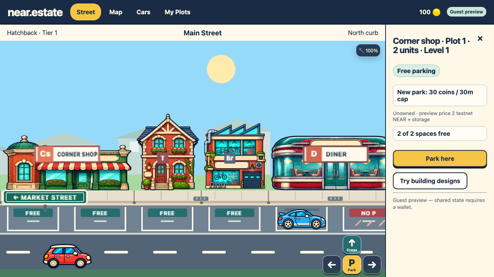

# near.estate

A 2D city-parking game whose economy runs on a NEAR testnet contract. Players drive through a side-scrolling city of five roads, park to earn coins, repair and upgrade cars, buy street plots, set the parking rules in front of them, and customize the buildings with moderated logos and billboards. Built for the NEAR HACKATHON **Games With Real Economies** track (`games`).



## The problem it explores

Most on-chain games make the chain the gameplay: wallets, popups and tokens come first. near.estate makes **scarce, player-owned curb space** the gameplay and keeps the chain in the background:

- **Scarce space.** There are 180 curb spaces in front of 100 player plots, plus three game-owned towers with 96 spaces. Each space holds one car at a time, and the contract enforces capacity.
- **Owners set the rules.** Each plot's owner chooses Free, Meter (they collect a fee, capped at half the driver's earnings), ColorOnly or NoParking. A new rule takes effect after five minutes.
- **Tickets.** Owners ticket illegal parkers and keep 70% of what the session had earned. An inspector NPC patrols too, within limits set by the contract.
- **Sessions end on their own.** Parking earns for at most 30 minutes. Anyone can then settle the expired session, which pays the original driver and frees the space.
- **No wallet popup per action.** After one wallet approval, parking, collecting, ticketing, repairs and rule changes are signed in the page with a restricted gameplay key. That key cannot attach deposits or call any other method.

Coins are nontransferable testnet game points. Plots cost testnet NEAR. See [docs/GAME_RULES.md](docs/GAME_RULES.md) for the exact numbers.

## Try it: do X, see Y

You need Node 22 and a shell. Steps A–C need no wallet, keys or testnet NEAR.

### A. Play the guest city (about 2 minutes)

Guest mode runs the same game rules against local sample state, so nothing is written to the chain.

1. Run `npm ci`, then `npm run dev:guest`, and open http://localhost:5173. **You see** Main Street, your red hatchback on the road and a balance of 100 coins.
2. Click **Park here**, or press Space. **You see** the car pull into the curb, durability drop to 98% and a **Collect** button appear.
3. Click **Collect**. **You see** the car back on the road with its earnings added.
4. Open **Cars** and click **Repair to full · 2 coins**. **You see** "Repaired Hatchback by 2 points" and 100% durability.
5. Open **Menu → My Plots**, then click **Visit plot**. A visitor is parked illegally on your curb. Click **Ticket**. **You see** "Ticketed visitor".
6. Open **Map** and click **Main Parking Tower**. **You see** the action change to **Park in tower**, which works even when every curb is full.
7. The map also leads to the cinema, the burger stop, the solo practice course and Harbor Horse Course. Watching a horse race is free and leaves coins and durability unchanged.

### B. Verify the live testnet game without keys (about 2 minutes)

```sh
npm run judge:verify
```

**You see** about 30 `PASS` lines and then `All checks passed.` The script uses only read-only RPC calls. It:

- checks that the live contract's code hash matches [deployments/testnet.json](deployments/testnet.json);
- reads the city from contract views: 100 plots, 180 curb spaces, three towers of 32 spaces, and separate admin, moderator and inspector roles;
- re-fetches every recorded journey transaction from an archival node, then checks its outcome and its `near_estate` events.

Each transaction prints with a testnet explorer link. [EVIDENCE.md](EVIDENCE.md) maps each claim to its record.

### C. See the shared testnet street

1. Run `npm run dev:city` and open http://localhost:5173.
2. Click **Testnet street** in the top bar. **You see** "Viewing shared testnet street." The buildings, owners' names, parking rules, prices and free spaces now come from the contract on testnet.
3. Click a plot. **You see** its owner state, testnet NEAR price and current occupancy.

Without the service database, approved logos and billboards appear as initials.

### D. Play on testnet with a wallet (human judges)

Click **Wallet** to connect a [Meteor](https://meteorwallet.app) testnet account that holds a little testnet NEAR. The game then:

1. registers the account with a storage deposit, granting 100 coins and a starter car;
2. asks for one approval of the restricted gameplay key;
3. parks and collects with no further popups.

This browser path has not yet been completed end to end with a named wallet, so treat it as unverified. The same contract calls are proven by the scripted journeys in step B.

### E. Run the test suites

- `npx playwright install chromium --only-shell`, then `npm run test:browser`, runs 54 guest browser journeys at desktop and phone viewport sizes in about 3 minutes.
- `npm run check` runs the workspace type checks and unit tests.
- `npm run contract:test` needs Rust with the `wasm32-unknown-unknown` target.

## What is on-chain

**Live contract:** [`dev-20261110121817-59798568433631.testnet`](https://testnet.nearblocks.io/address/dev-20261110121817-59798568433631.testnet), code SHA-256 `27e17dd1…c88a646`.

The contract owns:

- accounts, coins and cars;
- plot ownership, rules, tickets and building levels;
- every parking session, with its frozen economic terms;
- the approved artwork and media hashes.

A Node/SQLite service handles image uploads, moderation, ad-impression estimates and an event indexer that reads only finalized blocks. The live code is built from [`contracts/city-migration`](contracts/city-migration); the version-1 rules it ports live in [`contracts/estate`](contracts/estate).

## Timeline

The repository history begins with a baseline commit that squashes development through 2026-11-10 (UTC). The testnet contract and its role accounts were created on 2026-11-10 at 12:18 UTC (`dev-20261110121817-…`). The variable-width version-2 city went live on 2026-11-12; see its [release record](deployments/variable-city-release-db33845c80179c1a.json).

## Known limits

[EVIDENCE.md](EVIDENCE.md#not-done-or-known-limits) lists them all. In short:

- No named wallet has completed the browser journey yet.
- Phones have only been checked in emulated viewports.
- Advertiser impressions are estimates.
- Paid AI image generation is switched off, so building facades are curated.
- Horse racing is a free spectator activity. A separate local betting simulation does not use game coins; on-chain wagering is not enabled.
- The invite beta is not yet released; see [docs/RELEASE_CHECKLIST.md](docs/RELEASE_CHECKLIST.md).

## Development

`dev:guest` starts the instant local city with hot reload. `npm run dev:city` starts a web-only preview of the deployed testnet street and wallet chooser. It reads the contract ID from `deployments/testnet.json` and keeps live chain reads available; approved artwork, uploads, impressions and stats return a clear 503 because no local service database is attached. To work with approved artwork and stats, run `npm run dev:city:snapshot -- /absolute/path/to/migrated/private/media`. It creates a protected, ignored snapshot under `data/dev-city-snapshots` and prints the `API_DATA_DIR=... DEV_INDEXER=0 npm run dev:city` command to start the API against that copy. The snapshot uses SQLite's backup operation and checks the hash of each copied image. The city command reads the current deed cutover and reopen times from its active release record. With `DEV_INDEXER=0`, stats reflect the snapshot's cursor; set `DEV_INDEXER=1` on the copy when current indexed activity is needed. For another contract, set `INDEXER_START_HEIGHT` to that contract's creation height. The app opens at `http://localhost:5173`. If ports are occupied, set `WEB_PORT` and `API_PORT` together, for example `WEB_PORT=5176 API_PORT=3001 npm run dev:city`. Both commands require one terminal and stop their local processes with Ctrl-C.

For the quick edit loop, keep the chosen dev command running: Vite refreshes street/UI changes, shared game code recompiles on change, and the API and indexer restart after service edits when a migrated service directory is attached. Run `npm run test -w @estate/web` or `npm run test -w @estate/api` for the part you changed. With `dev:guest` already running, use `npm run test:browser:local` to check guest journeys without a second server or build; set `ESTATE_BROWSER_LOCAL_URL` if its port differs from 5173. `npm run test:browser` still starts and stops its own guest server on port 5187 for an independent run. The suite covers park/collect/repair/ticket, full-curb tower fallback, complete practice and cinema journeys, plus screen navigation and horizontal-overflow checks at desktop, phone landscape and phone portrait sizes; its first local run needs `npx playwright install chromium --only-shell`. Run browser tests separately from `npm run check` because both commands use the shared build output. Run `npm run check`, `npm run assets:check`, and `npm run contract:test` at the relevant phase gate. The repository's `.cargo/config.toml` supplies the NEAR host-function build flag for WASM, and the contract rejects a WASM build that omits it. Rust contract changes still need a new testnet deployment before Live city can show them.

With `dev:guest` running, use `npm run profile:street` in another terminal for an eight-second driving sample at desktop and phone-sized browser viewports. Set `ESTATE_PROFILE_URL` if the dev server uses another port; `--travel-cycles 20` adds rapid map and curb travel in one page, while up to 200 cycles allow a longer cache and JavaScript-heap check. `--out /path/to/report.json` saves the result. This local browser check does not measure a physical phone or GPU memory.

For a contract code swap, `npm run contract:layout:check` runs the frozen storage-layout tests locally. The testnet code-upgrade tool runs this guard automatically before its sandbox rehearsal or live apply. A changed layout needs a migration procedure instead of the ordinary code-upgrade path.

With `dev:city` running against a migrated `API_DATA_DIR`, `ESTATE_BROWSER_LIVE_URL=http://localhost:5173 npm run test:browser:live` checks the public testnet street and advertiser stats in Chromium. It uses the running city and API, makes no wallet transaction and fails if the indexed block is over ten minutes old. Set the URL to your chosen `WEB_PORT` when different. For an isolated local data snapshot with its indexer disabled, add `ESTATE_BROWSER_SNAPSHOT=1`; this skips only the ten-minute cursor check and is accepted only with a localhost URL.

For the second-wallet compatibility spike, start a separate local city with `VITE_EXPERIMENTAL_INTEAR=1 npm run dev:city`. This adds Intear to the local wallet chooser; normal builds show Meteor only. With that city running, set `ESTATE_EXPERIMENTAL_INTEAR=1` alongside `ESTATE_BROWSER_LIVE_URL` to check that Intear's connection screen opens. Sign-in, artwork signing and gameplay-key approval still need a real-wallet test before this option can be released.

The repeatable two-account testnet ticket journey uses separate private owner and driver credential files. Set `ESTATE_OWNER_KEY_FILE` and `ESTATE_DRIVER_KEY_FILE` to absolute paths outside this repository, run `npm run testnet:two-account:plan`, then `npm run testnet:two-account:apply`. Apply buys one dedicated shared-city plot at the quoted testnet NEAR price, schedules NoParking, and exits until the five-minute rule delay passes. Run apply again after that deadline to park the driver's car illegally, ticket it from the owner account, and schedule Free as the restored rule. After Free becomes effective, `npm run testnet:two-account:verify` checks the final state and transaction outcomes. The private journal lets an interrupted run check the exact signed transaction before continuing. This tests direct signed contract calls; named browser wallets have a separate release gate.

With the same two private credential paths, `npm run testnet:contested-curb:plan` checks an unowned Free curb and both cars, then `npm run testnet:contested-curb:apply` signs and broadcasts two park attempts for that one slot, verifies one winner and one loser, and collects the winner. Its private journal retains exact signed bytes if a network reply is lost. Set `API_DATA_DIR` to the running city's SQLite data directory and run `npm run testnet:contested-curb:indexed` to verify exactly one park and one collection reached the event index.

`npm ci` applies two Meteor dependency manifest patches and an experimental Intear browser-message guard from `patches/`. Keep install scripts enabled; `npm ls` and the production audit are checked in the [release checklist](docs/RELEASE_CHECKLIST.md).

The web app starts in guest mode with local mock state. Guest actions do not affect shared ownership or rewards. To show the separate **Live city** screen after deploying the contract, set `VITE_ESTATE_CONTRACT_ID` to the deployed `.testnet` account before starting or building the web app. The live screen reads the selected street side and supports wallet-backed registration, purchases, curb and tower parking, collection, tickets, and repairs. The illustrated Street has an explicit testnet switch: it renders chain-backed buildings, rules, occupancy, selected car and balance, and uses the restricted key for parking, collection and owner tickets. Guest mode stays local. Two-account journeys have been signed directly with testnet keys (see [EVIDENCE.md](EVIDENCE.md)); a named browser wallet has not yet completed them.

For a local **parking agent**, create a separate protected key with `npm run agent:key:new -- --account player.testnet`, then connect that account in Live city and paste the printed public key into the Parking agent card. Run `npm run agent:run -- --account player.testnet --car-id 1 --key-file /absolute/path/player.testnet.key.json` on the agent computer, using the chosen car's ID. This agent can only park, collect and settle expired parking; its key has a 0.05 testnet NEAR gas allowance and cannot spend game coins. Revoke the agent key in Live city to stop its on-chain access. Browser wallet disconnect does not revoke it. The plot/building-agent implementation is in source but awaits a contract runtime release; see [the agent guide](docs/GAME_LOOPS_AND_AGENTS.md).

## Testnet deployment

`npm run deploy:plan` builds the exact release WebAssembly, validates the city seed, and prints its SHA-256 without contacting testnet. The shared testnet city is recorded in [deployments/testnet.json](deployments/testnet.json): 100 variable-width plots (180 curb spaces) and seven game-owned sites, running the version-2 code from its [release record](deployments/variable-city-release-db33845c80179c1a.json). A [restricted-key check](deployments/testnet-gameplay-key.json) passed method, deposit and receiver limits, allowance exhaustion and on-chain revocation. An [event-source probe](deployments/testnet-event-source.json) matched a finalized contract receipt between Neardata and archival RPC and rediscovered its transaction from the archived block. Wallet UI transactions still need testing with Meteor and a second active wallet. The deployment and credential procedure is in [deployments/README.md](deployments/README.md). The contract restricts first initialization to the contract account.

## Trust boundary

Ownership, parking capacity and terms, game coins, rules, tickets, building levels and approved appearance hashes belong on-chain. The operator controls image hosting, prompt generation, moderation decisions, impression estimates, the event indexer, the inspector account and the expiry sweep. The inspector account is limited by contract rules, but can still choose or omit targets. The expiry account can only call the public `settle_expired` method through its runtime key; the contract decides whether a session has expired and what it pays. No game coin has a redemption or transfer method in V1.

Operator setup, incident procedures and state recovery are documented in [Operations](docs/OPERATIONS.md), [Incidents](docs/INCIDENTS.md) and [Recovery](docs/RECOVERY.md).

The VPS deployment uses [the production Compose override](infra/compose.prod.yaml), [optional expiry sweep](infra/compose.expiry.example.yaml) and [domain Caddyfile](infra/Caddyfile.prod); public TLS issuance and invite-beta release remain unverified.

## Layout

Phone driving uses landscape; menus and the building studio also work in portrait. Desktop has a wide scene and a dismissible plot panel. The [phone](docs/images/near-estate-phone-layout-v1.png) and [computer](docs/images/near-estate-computer-layout-v1.png) sheets are references, not screenshots of the app.

See the [current game visuals](docs/VISUALS.md) for street and building studio captures, plus the illustrated building draft sheet. The [building image specification](docs/BUILDING_IMAGE_SPEC.md) records the prompt and size rules. The [building ad guide](docs/ADS.md) explains image upload, preview, billboard placement and approval. Guest image previews stay local; live owner publication uses the approval flow.

## Status

The [numbered progress tracker](docs/PROGRESS.md), [decisions](docs/DECISIONS.md) and [invite-beta release checklist](docs/RELEASE_CHECKLIST.md) show verified work and unverified gates. The [recovery runbook](docs/RECOVERY.md) covers the shared SQLite volume, immutable artwork and deployment records. Do not use a local build as evidence of a completed testnet or paid-generation phase.
