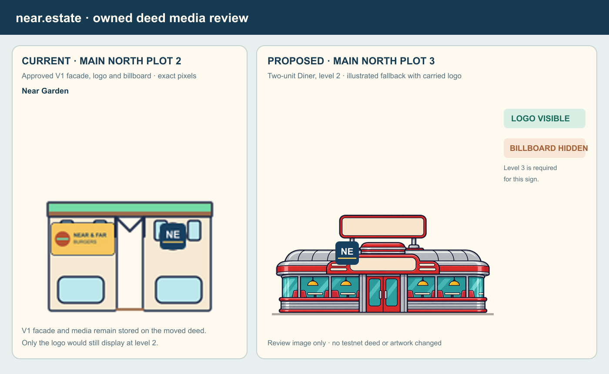

# Owned deed artwork during the variable city move

This is a review of the **proposed** migration, based on the read-only testnet
inventory at finalized block `277305482` and state hash
`036249aa91634c3605427df4d20b696003a9d3a7dd15e135d0d6ae571b45e424`.
It is not owner acceptance or a release approval. The live contract and deeds
have not been changed.

The [location sheet](images/near-estate-deed-move-review-v1.png) shows where
both deeds would move relative to Central Avenue. The Main Street deed would
move next to that junction, which still needs an owner location decision.

| Deed                         | Proposed destination                          | What the player would see after migration                                                                                                                                                                                                                                                      |
| ---------------------------- | --------------------------------------------- | ---------------------------------------------------------------------------------------------------------------------------------------------------------------------------------------------------------------------------------------------------------------------------------------------- |
| `plot-main-n-2`, Near Garden | `plot-main-n-3`, two-unit Diner, level 2      | Built-in Diner frontage with the approved **NE** logo on its sign. The existing custom V1 facade remains on the deed but is not a compatible V2 sprite. The approved Near & Far Burgers billboard remains on the deed but is hidden because this design supports billboards only from level 3. |
| `plot-market-n-1`            | `plot-market-n-2`, two-unit building, level 1 | No approved custom facade, logo or billboard is carried. The destination uses its built-in design.                                                                                                                                                                                             |

The approved Main Street logo hash is
`a7ceb962124bd4f3c1b6db35e8f47f6e5cfc0c6bd9e0596b613750084cbc4ef8`;
the billboard hash is
`1b11c8acecb84f03bb9590c5a31c72fdb62d58aca3ce6a5d3c1247d2ad192898`.
The review image regenerates their exact processed PNG bytes from the original
testnet upload fixtures and checks both hashes against the pinned on-chain
inventory. The left panel composites those bytes onto the actual public V1
facade thumbnail recovered from the local API data, using the same moderation
preview compositor. The saved [V1 manifest](review-data/near-garden-v1-manifest.json)
and [thumbnail](images/near-estate-approved-v1-near-garden-thumbnail.png)
match their public hashes; the manifest hash recorded on-chain is
`31645fe6ccac1fea2281fb868e8626b2808af3b63467defa47cc39dddff1edcb`.
The right panel uses the checked level-2 Diner sprite and the same V2 logo
rectangle as the game. It is a game-size comparison, not a captured live
migration.

The imported-state sandbox confirms that the moved deed retains the old media
state, that its one approved logo remains eligible, and that the billboard is
not eligible at level 2. The V2 client only draws a custom facade from a V2
manifest, so the old facade has a built-in fallback. The pictured logo assumes
the asset service serves its approved hash after the cutover. The local API
currently serves the facade, logo and billboard anonymously with matching
hashes; that hosting path has not been verified against the eventual VPS backup.

Regenerate or verify the image with `npm run city:migration:media-review` or
`npm run city:migration:media-review:check`. Repeat the pinned inventory and
review after any owner, building, level, media or code change. Keep the deed
map in draft until the owner accepts both location and visible artwork.
