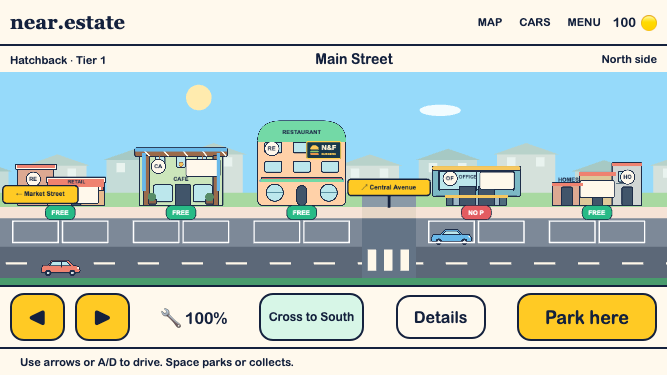
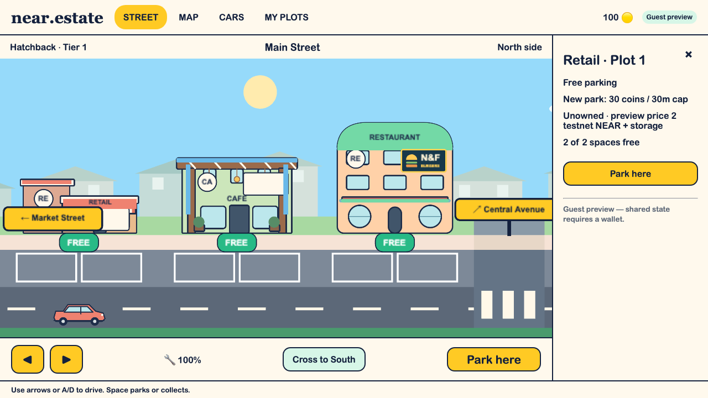
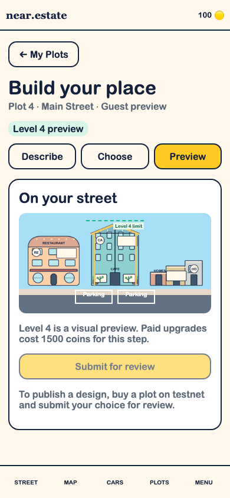
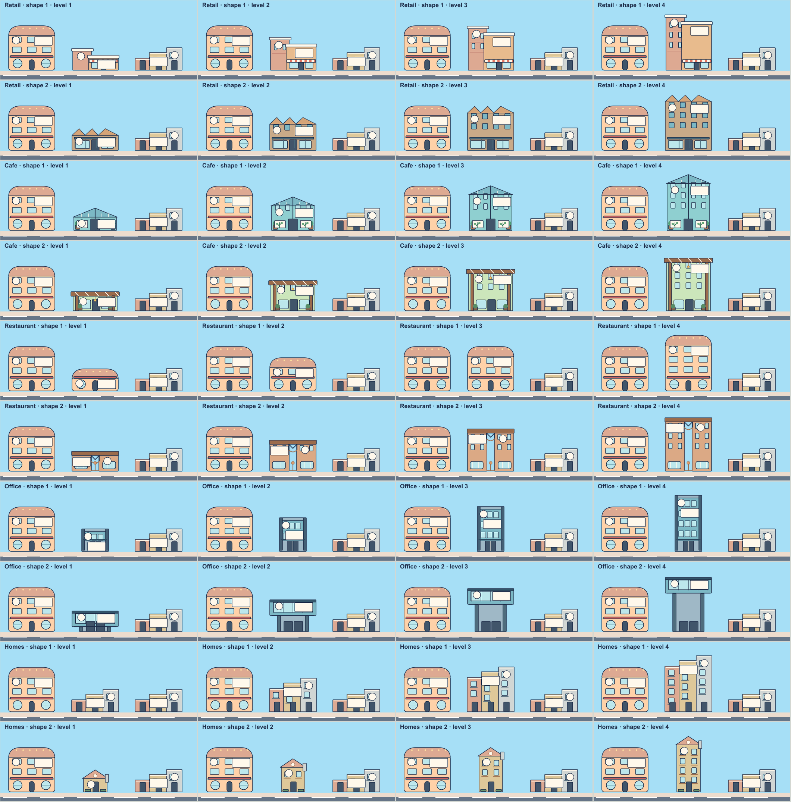

# Current game visuals

These are the latest saved visuals for the curated-only near.estate beta. The first three are captures of the running guest game at the stated browser viewports. They show the implemented interface and generated preset art, but do not prove physical-phone performance or wallet signing. The restaurant's Near & Far Burgers billboard is a guest-only sample; live billboards require on-chain approval.

## Street on a phone

667 × 375 landscape. The driving buttons, parking action, curb spaces, rule signs and cross-street control are visible.

## Street on a computer

1280 × 720. The plot details sit beside the street and can be dismissed.

## Building studio on a phone

390 × 844 portrait. The owner can compare a selected building with its neighbours before submitting it for review. This capture is a guest preview; publishing requires a purchased plot and wallet.

## Building variations and upgrades

The sheet below places each of the 40 implemented curated facade sprites beside the same neighbours. It covers five building types, two shapes per type and four levels. The current local art pass gives each type a stronger material color and adds foliage inside the greenhouse cafe. It is an asset review sheet; the street renderer adds names, logos, billboards and parking signs separately.

The [art specification](ART_SPEC.md) explains the size limits, palettes, source assets and review checks. The older [phone layout concept](images/near-estate-phone-layout-v1.png) and [car concept sheet](images/near-estate-cars-v1.png) are design references rather than current game screenshots.

The [street visual review](VISUAL_REVIEW.md) records the next art changes suggested by these captures.
