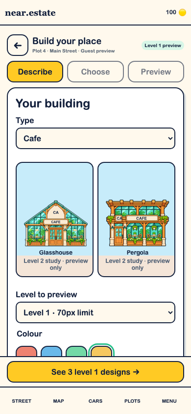
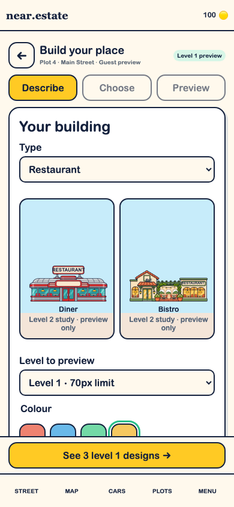
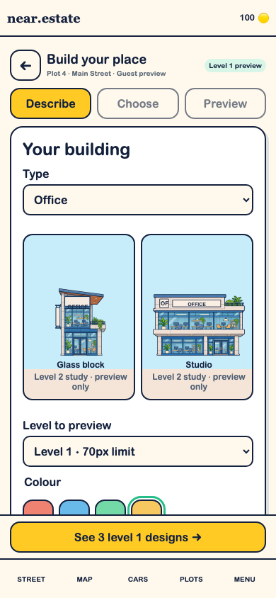
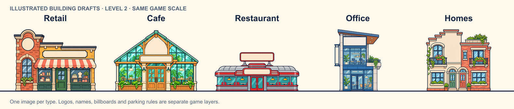
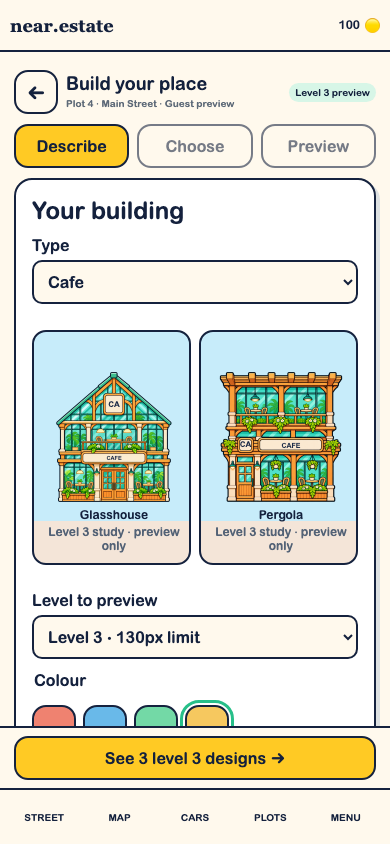
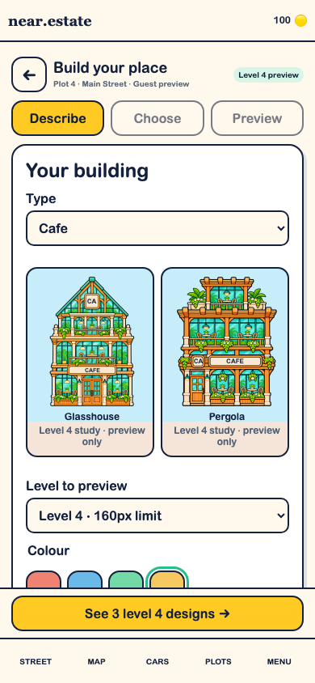
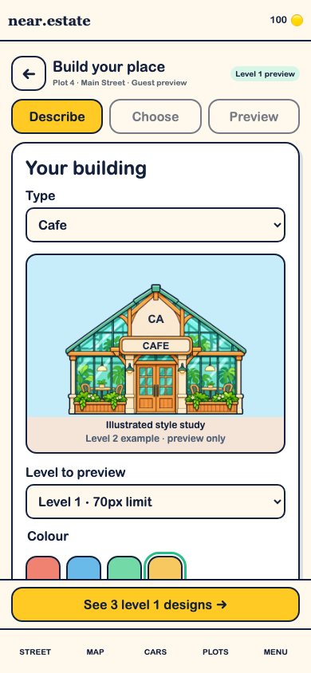
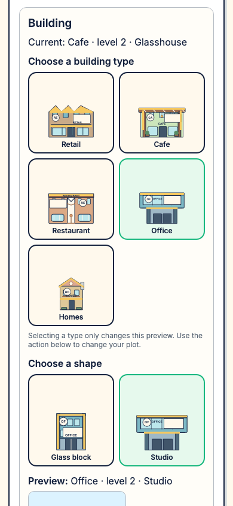
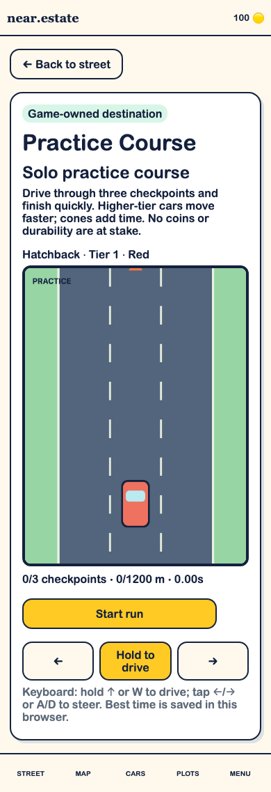

# Current game visuals

These are the latest saved visuals for the near.estate guest game. The street captures show the revised controls and illustrated facades: both shapes of all five types at level 2, plus all four levels of both Cafe shapes. These are operator-created guest previews; the live city still uses approved artwork and procedural presets. These browser captures do not prove physical-phone performance or wallet signing. The restaurant's Near & Far Burgers billboard is a guest-only sample; live billboards require on-chain approval.

## Street on a phone

667 × 375 landscape. The car, coins, street and navigation share one row. The driving buttons, parking action, curb spaces, rule signs and cross-street control remain visible.

Driving further along Main Street reveals the Market hall's sawtooth roof beside the triangular Glasshouse Cafe.

## Street on a computer

1280 × 720. The plot details sit beside the street and can be dismissed.

## Illustrated building drafts

The portrait builder shows both illustrated directions for the selected type at game size, with labels shared with the owner shape picker. These are read-only style studies; the three selectable looks below remain the curated presets. The pair views show clear changes in roofline, width, entrance position and materials.

The alternate Bistro, Studio and Townhouse also appear in the [Market Street](images/near-estate-illustrated-pairs-market-phone-v2.png), [River Street](images/near-estate-illustrated-pairs-river-phone-v2.png) and [Central Avenue](images/near-estate-illustrated-pairs-central-phone-v2.png) captures.

The earlier equal-scale sheet has one level-2 facade per type. The ten-image trial covers both shapes at level 2, not the complete four-level illustrated library.

The [image specification and generation prompt](BUILDING_IMAGE_SPEC.md) records the style, size limits and future owner-generation path.

## Cafe upgrade progression

Selecting a Cafe preview level now switches both illustrated shapes to separate images for that level. The roofs keep their triangular Glasshouse and flat Pergola identities while the upper floors grow. The fixed bottom action still names the chosen level on a portrait phone.

The level-3 Glasshouse appears on [Main Street](images/near-estate-cafe-glasshouse-level3-street-phone-v3.png), and the level-4 Pergola appears on [Central Avenue](images/near-estate-cafe-pergola-level4-street-phone-v3.png), both anchored at the sidewalk without covering curb signs or spaces.

## Building studio on a phone

390 × 844 portrait. The guest studio shows the selected type's two illustrated style studies before the curated design choices. Cafe art follows the selected level; the other types currently show their available level-2 studies with a clear caption. A persistent button names the selected preview level and stays above the phone navigation while Describe is open, so the next step remains visible while scrolling the form. The style studies are preview-only. The later Choose and Preview steps still compare the current curated designs beside neighbours; publishing requires a purchased plot and wallet.

The [320-pixel phone capture](images/near-estate-studio-next-action-320-v1.png) checks the narrow layout. The [desktop studio](images/near-estate-studio-illustrated-desktop-v1.png) shows the same study beside the existing candidate and neighbourhood areas.

The Choose step now has Previous and Next buttons so a player can compare all three looks before opening the street preview. Selecting a thumbnail stays on Choose. This 320-pixel capture shows the controls with a level-2 cafe.

## Owner building choices

The wallet-backed owner editor shows all five curated building types as visual choices. Each type has two named shape cards; selecting a card changes the draft preview. Selecting Office on a Cafe plot reveals the 50-coin type-change action; it does not change the plot until the owner confirms. The phone and [desktop](images/near-estate-owner-building-types-desktop-v3.png) captures use a local owner-state fixture, so they verify layout and draft controls rather than wallet signing.

The [shape comparison](images/near-estate-owner-building-shapes-phone-v1.png) shows Glass block beside Studio, followed by the selected building at game scale and the type-change action. The [320-pixel level-4 capture](images/near-estate-owner-shapes-level4-320-v1.png) checks the tallest facades without thumbnail clipping.

For the current building type, four named colour choices update the curated preview. A type change keeps the current colour and name on-chain, so those controls appear after the change has confirmed.

## Building variations and upgrades

The sheet below places each of the 40 implemented curated facade sprites between the same game-owned burger stop and level-1 home. It covers five building types, two shapes per type and four levels. Higher levels now add type-specific features such as market gable windows, cafe vines, a diner awning and residential balconies. It is an asset review sheet; the street renderer adds names, logos, billboards and parking signs separately.

## Solo practice course on a phone

390 × 844 portrait, captured from the running guest game. The full course journey was also driven to the finish in a local browser; it saved a personal best without changing parking coins or durability.

## Harbor Cinema on a phone

390 × 844 portrait, captured during the free 18-second short. A local browser journey paused, resumed, finished and replayed it without changing parking coins or durability.

The [art specification](ART_SPEC.md) explains the size limits, palettes, source assets and review checks. The older [phone layout concept](images/near-estate-phone-layout-v1.png) and [car concept sheet](images/near-estate-cars-v1.png) are design references rather than current game screenshots.

The [street visual review](VISUAL_REVIEW.md) records the next art changes suggested by these captures.
